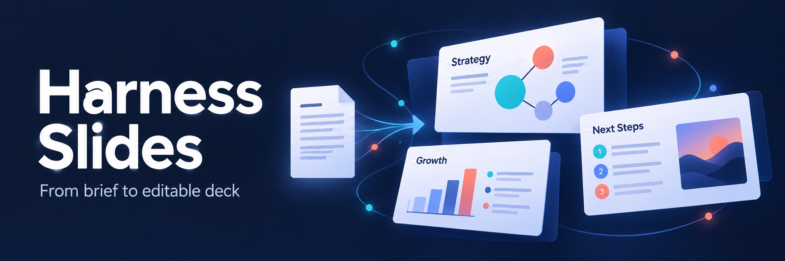

# Harness Slides



Create **editable PowerPoint or Google Slides presentations** with Claude Code,
Codex, or Cursor. Bring a brief, source documents, or an existing deck. Your
agent handles the story, design, build, and visual review.

## Get started

### 1. Install

You need **Git**, **Node.js 20+**, **Python 3.9+**, and one of the agents above.
Run this in your terminal:

```sh
git clone --branch v0.14.1 --depth 1 https://github.com/dbbaskette/harness-slides-skill.git
cd harness-slides-skill
bash scripts/Install-Harness-Slides.sh
```

The installer adds the skill to all three agents. Look for `"status": "installed"`
and `"dependencies": "installed"` in the result, then start a new agent session.

[Published release: v0.14.1](https://github.com/dbbaskette/harness-slides-skill/releases/tag/v0.14.1)
· [Development changes: 0.15.0, unreleased](docs/releases/unreleased.md)

### 2. Open your project

Open the folder where you want your deck saved. Add your brief or source files;
for example, save a short brief as `brief.md`.

### 3. Ask for a deck

Send this in your **agent's chat**:

```text
/harness-slides Create an editable PowerPoint deck from brief.md for a
10-minute customer presentation. Use only this brief and visually review
every slide before handing it back.
```

- **Claude Code:** use `/harness-slides` as shown.
- **Codex:** replace `/harness-slides` with `$harness-slides`.
- **Cursor:** start with “Use the harness-slides skill” instead.

No brief yet? Ask: “Use the harness-slides skill to build the bundled PowerPoint
example in ./example-work and open its preview studio.”

## What happens next

1. **Approve the story.** Review a draft of the whole deck and adjust its wording
   and order.
2. **Choose the look.** Pick from rendered sample slides, or use your established
   template and style.
3. **Build and review.** The agent builds editable slides, inspects the rendered
   output, and fixes problems.
4. **Make final changes.** Review the slides, request revisions, and receive the
   editable deck with any remaining limitations explained.

You can ask for an autonomous build. You never need to write JSON or run the
internal helpers.

## Choose your format and style

| Want | Include in your request |
| --- | --- |
| PowerPoint | “Editable PowerPoint” or “.pptx.” No Google account is needed. |
| Google Slides | “Google Slides.” This is the default and needs authorized Google access. |
| Your branding | Supply a company template or name an installed brand skill and the brand to use. |
| A neutral look | Ask for an unbranded deck. Branding is optional. |

For Google access, see [Google setup](references/google-slides.md).

## Edit a deck or continue later

Use the same skill entrypoint for follow-up requests:

| Task | Example request |
| --- | --- |
| Polish an existing deck | “Polish launch.pptx on slides 3–6. Keep the wording, slide order, and notes. Work on a copy.” |
| Revise one slide | “Make slide 4 easier to read. Keep its claims and chart data.” |
| Open the editor | “Open the preview studio for ./deck-work.” |
| Resume a project | “Continue the deck in ./deck-work and fix the remaining findings.” |
| Restore earlier work | “Show the saved versions of ./deck-work so I can choose one to restore.” |

Use the project path your agent returns. The studio is useful for quick edits;
its browser preview is approximate. Inspect the actual PowerPoint or Google
Slides render before sharing the deck.

## Add images

Supply your own images, or ask for a custom illustration. Built-in custom image
generation uses the **Gemini API**, requires `GEMINI_API_KEY`, and is paid. The
agent explains the planned images and cost and waits for approval before
creating them. Never paste API keys into chat.

The Gemini API route is not yet verified live. See [image setup and usage](references/images.md)
for key setup, provider options, and limitations.

## Need help?

- **The skill is missing:** confirm installation succeeded and start a new agent
  session.
- **The command fails in a terminal:** `/harness-slides` and `$harness-slides`
  belong in your agent's chat.
- **A build or render tool is missing:** ask the agent to check the prerequisites
  and prepare the required local tools.
- **Google access is unavailable:** follow [Google setup](references/google-slides.md)
  or request a local PowerPoint deck.

To update, install a newer published release with the same installer. Guidance
refreshes automatically for new work; executable helpers update through the
installer. Existing projects keep their saved runtime so you can resume them.
See [versions and updates](docs/releases.md) for details.

## For developers

See [development setup and checks](docs/development.md),
[verification and known limits](docs/verification.md), and
[instruction context measurements](docs/context-usage.md).
